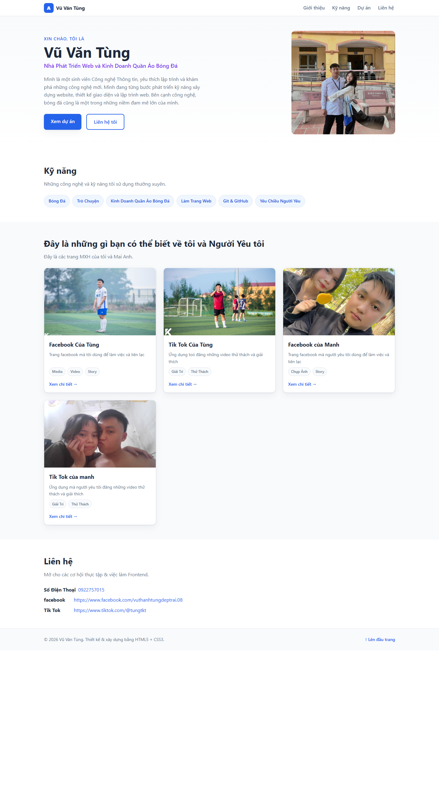
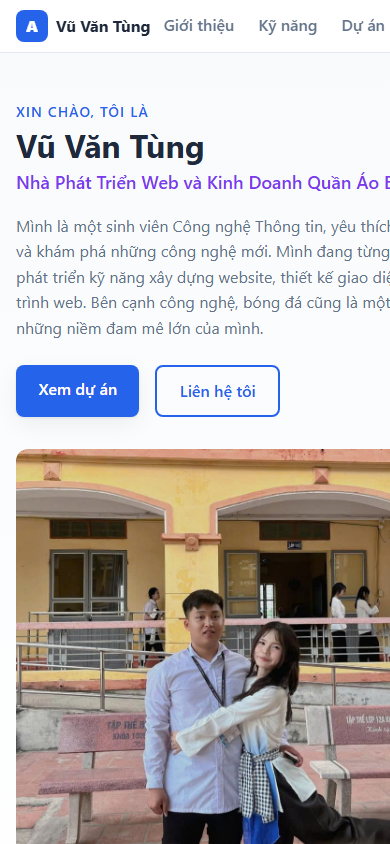

# Báo cáo kiểm thử

## Thông tin chung

- **Dự án:** Portfolio cá nhân – Vũ Văn Tùng
- **Phiên bản:** v1.0
- **Ngày kiểm thử:** 2026-10-27
- **Phạm vi:** Website tĩnh trong phạm vi mã nguồn hiện tại.
- **Môi trường:** Microsoft Edge trên Windows; trang được mở cục bộ từ `index.html`. Kiểm tra responsive ở các viewport 390 px, 900 px và 1366 px bằng trình duyệt.
- **Phương pháp:** Kiểm tra nội dung và điều hướng trên trình duyệt, kiểm tra trạng thái tải tài nguyên, quan sát bố cục ở nhiều kích thước và rà soát mã nguồn tĩnh. Đây không phải kiểm thử xâm nhập hoặc kiểm thử trên thiết bị vật lý.

## Tổng hợp kết quả

| # | Tiêu chí | Kết quả | Tóm tắt |
|---|---|---|---|
| 1 | Tính đúng đắn | Đạt | Các phần nội dung chính hiện diện; điều hướng nội bộ hoạt động; ảnh và CSS tải thành công. |
| 2 | UI/UX | Đạt có điều kiện | Lưới đổi 1/2/3 cột theo kích thước; không phát hiện tràn ngang ở các viewport đã thử. Chưa kiểm thử trên thiết bị thật. |
| 3 | Khả năng vận hành - xử lý lỗi | Đạt trong phạm vi trang tĩnh | Trang mở cục bộ và tải đủ tài nguyên; không có API, biểu mẫu hay logic ứng dụng để kiểm thử luồng lỗi. |
| 4 | Bảo mật | Đạt ở mức rà soát tĩnh cơ bản | Không thấy script, biểu mẫu nhập liệu hoặc cấu hình bí mật trong phạm vi kiểm tra; chưa thực hiện kiểm thử bảo mật chuyên sâu. |
| 5 | Chất lượng mã nguồn | Cần cải thiện | Có cấu trúc HTML ngữ nghĩa và CSS responsive; một số văn bản thay thế ảnh chưa khớp nội dung ảnh và nội dung hiển thị cần rà soát. |
| 6 | Khả năng triển khai | Đạt ở mức chạy cục bộ | Trang tĩnh chạy trực tiếp từ tệp HTML; Docker và môi trường hosting/staging chưa được kiểm thử thực tế. |

## 1. Tính đúng đắn

- Xác nhận trang có tiêu đề, ngôn ngữ `vi` và đủ bốn phần chính: giới thiệu, kỹ năng, dự án và liên hệ.
- Các liên kết điều hướng đến `#projects` và `#contact` cập nhật đúng đích.
- Kiểm tra được 5 ảnh nội bộ và tệp CSS tải thành công trong trình duyệt.
- Nội dung và liên kết mạng xã hội hiển thị trong trang phù hợp với cấu trúc hiện tại.

**Kết quả:** Đạt trong phạm vi kiểm thử thủ công trên trình duyệt. Chưa có bộ kiểm thử tự động hoặc tiêu chí nghiệp vụ độc lập để đối chiếu nội dung.

**Minh chứng:** [Ảnh toàn trang desktop](./screenshots/portfolio-fullpage.png), [ảnh giao diện desktop](./screenshots/portfolio-desktop.png).

## 2. UI/UX

- Giao diện được kiểm tra ở viewport 390 px, 900 px và 1366 px.
- Lưới thẻ dự án lần lượt hiển thị 1, 2 và 3 cột; không phát hiện tràn ngang ở các kích thước đã thử.
- Có trạng thái `focus-visible` cho điều hướng bàn phím và hỗ trợ tùy chọn giảm chuyển động của hệ điều hành trong CSS.
- Chưa kiểm tra trên điện thoại/máy tính bảng vật lý, chưa đánh giá đầy đủ độ tương phản hoặc khả năng tiếp cận bằng trình đọc màn hình.

**Kết quả:** Đạt có điều kiện; cần kiểm tra bổ sung trên thiết bị thật và rà soát khả năng tiếp cận trước khi phát hành rộng rãi.

**Minh chứng:**

## 3. Khả năng vận hành - xử lý lỗi

- Trang mở được trực tiếp từ `index.html`; CSS và toàn bộ ảnh được tham chiếu trong trang tải thành công ở lần kiểm tra.
- Đây là website tĩnh, không có JavaScript, backend, API hoặc biểu mẫu gửi dữ liệu; do đó không có luồng xử lý lỗi phía ứng dụng để kiểm thử.
- Chưa kiểm thử trường hợp triển khai thiếu tệp ảnh/CSS hoặc gián đoạn dịch vụ của các nền tảng mạng xã hội bên ngoài. Trang hiện chưa có cơ chế dự phòng cho tài nguyên tĩnh bị thiếu.

**Kết quả:** Đạt cho luồng mở và xem trang cơ bản; khả năng xử lý lỗi tài nguyên chưa được xác minh.

**Minh chứng:** [Ảnh toàn trang](./screenshots/portfolio-fullpage.png) và [mã HTML](../index.html).

## 4. Bảo mật

- Rà soát tĩnh `index.html` và CSS: không thấy thẻ script, biểu mẫu nhập liệu, iframe hoặc cấu hình API key trong phạm vi kiểm tra.
- Không có đăng nhập, xử lý dữ liệu người dùng, lưu trữ phía trình duyệt hoặc kết nối API do ứng dụng khởi tạo trong mã đã rà soát.
- Số điện thoại và liên kết mạng xã hội được hiển thị công khai trong nội dung trang; cần xác nhận chủ sở hữu đồng ý công khai các thông tin này.
- Chưa chạy công cụ phân tích bảo mật, kiểm thử xâm nhập, kiểm tra header HTTPS hoặc đánh giá dịch vụ hosting.

**Kết quả:** Không ghi nhận vấn đề qua rà soát tĩnh cơ bản; kết quả này không thay thế đánh giá bảo mật chuyên sâu.

**Minh chứng:** [Mã HTML](../index.html) và [ảnh khu vực liên hệ trong ảnh toàn trang](./screenshots/portfolio-fullpage.png).

## 5. Chất lượng mã nguồn

- HTML sử dụng các phần tử ngữ nghĩa như `header`, `nav`, `main`, `section`, `article` và `footer`; CSS sử dụng biến tùy chỉnh, Flexbox, CSS Grid và các breakpoint responsive.
- Có khai báo văn bản thay thế cho ảnh, tiêu điểm bàn phím và quy tắc `prefers-reduced-motion`.
- Một số `alt` của ảnh thẻ dự án đang ghi các mô tả mẫu như “Landing Page”, “Todo App”, “Weather Dashboard” và “Blog cá nhân”, không khớp với nội dung ảnh/liên kết thực tế.
- Nội dung hiển thị còn lỗi đánh máy và cách gọi tên chưa thống nhất; nên biên tập lại trước khi phát hành công khai.
- Chưa chạy HTML/CSS validator, linter hoặc kiểm thử tự động.

**Kết quả:** Cần cải thiện nội dung và văn bản thay thế ảnh; chưa phát hiện lỗi cấu trúc khiến trang không hiển thị trong lần kiểm tra này.

**Minh chứng:** [HTML](../index.html), [CSS](../assets/css/styles.css), [ảnh các thẻ dự án](./screenshots/portfolio-fullpage.png).

## 6. Khả năng triển khai

- Do dự án chỉ gồm tài nguyên tĩnh, có thể mở trực tiếp `index.html` hoặc phục vụ thư mục dự án bằng máy chủ web tĩnh.
- Xác nhận cách mở tệp cục bộ hoạt động; các đường dẫn tương đối đến CSS và ảnh phân giải thành công.
- README có hướng dẫn chạy thử và Docker với Nginx, nhưng Docker chưa được chạy để xác nhận; chưa triển khai lên staging hoặc hosting production.
- Không có bước build, biến môi trường hay backend cần cấu hình theo mã nguồn hiện tại.

**Kết quả:** Đạt cho xem thử cục bộ; trạng thái triển khai Docker/production chưa được xác minh.

**Minh chứng:** [Ảnh trang chạy cục bộ](./screenshots/portfolio-fullpage.png), [hướng dẫn chạy trong README](../README.md).

## Tệp minh chứng

Ảnh được chụp từ trang chạy cục bộ bằng Microsoft Edge ngày 2026-10-27 và lưu cùng báo cáo:

- [portfolio-desktop.png](./screenshots/portfolio-desktop.png)
- [portfolio-fullpage.png](./screenshots/portfolio-fullpage.png)
- [portfolio-mobile.png](./screenshots/portfolio-mobile.png)

## Kết luận

Phiên bản hiện tại đáp ứng việc trình bày portfolio tĩnh và có thể xem thử trực tiếp. Trước khi phát hành công khai, nên cập nhật `alt` theo đúng ảnh, biên tập lại nội dung, kiểm tra trên thiết bị thật và xác nhận các thông tin liên hệ được phép công khai. Docker, hosting production và kiểm thử bảo mật chuyên sâu nằm ngoài phạm vi đã thực hiện.